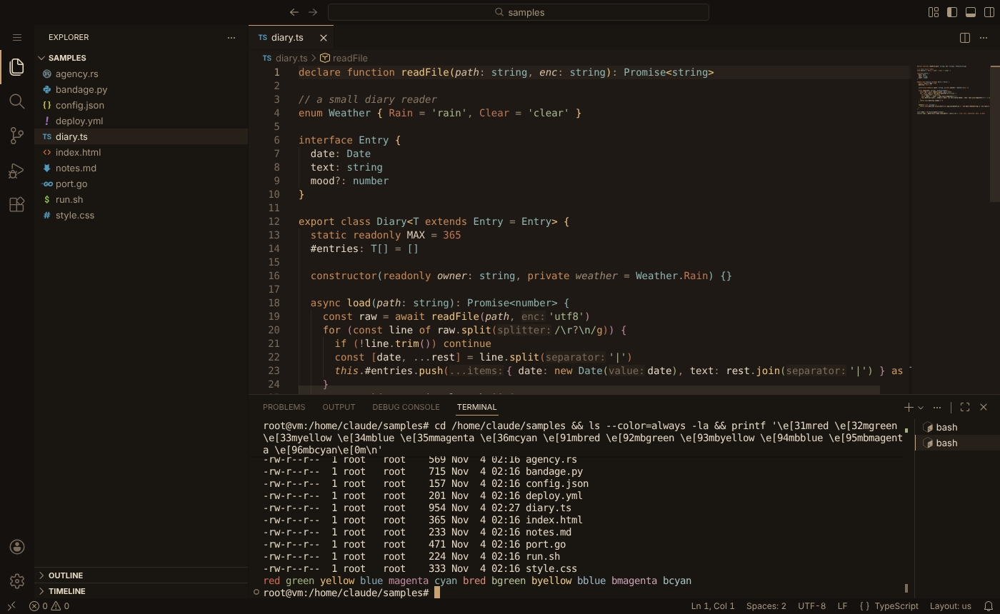
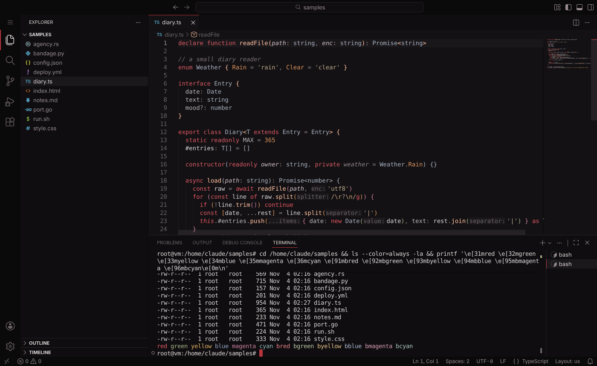
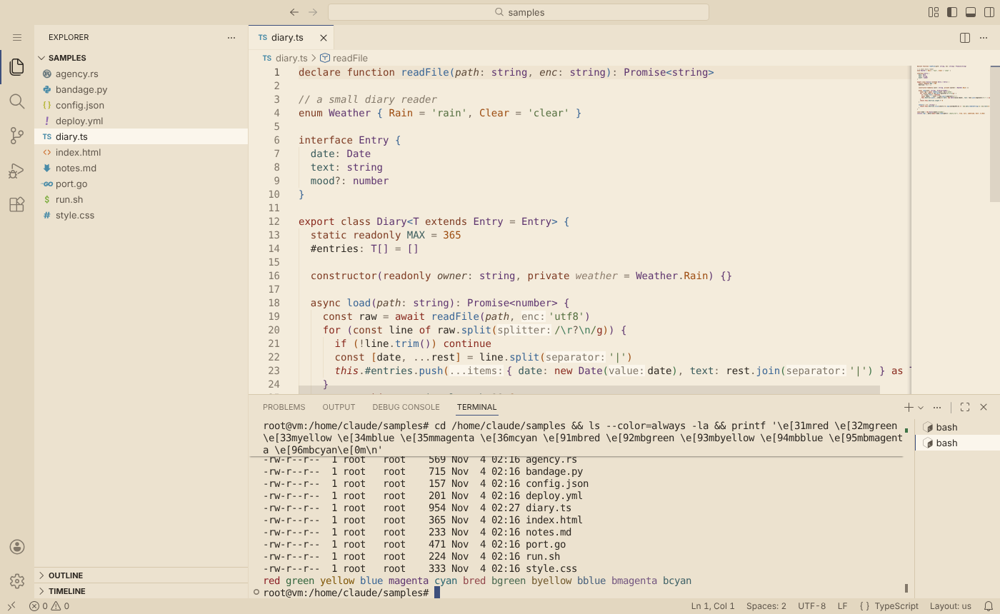

# Shikkaku

Three VS Code themes inspired by Dazai.

- **Shikkaku Agency** is warm and low key, sand coloured like the trench coat, with off-white text and a muted teal for types.
- **Shikkaku Mafia** is near black with deep red keywords, peach functions and cool grey types.
- **Shikkaku Paper** is the light one, taken from the author's side, old manuscript paper with ink text, red-brown keywords and indigo functions.

### Shikkaku Agency



### Shikkaku Mafia



### Shikkaku Paper



## What's covered

- Every code colour passes 4.5:1 contrast against the editor background, comments and line numbers sit a bit lower on purpose
- Colour blind friendly: keywords, functions, strings, types, numbers and the red, green and yellow status colours stay apart under protanopia, deuteranopia and tritanopia
- Over 500 workbench colours, checked against VS Code's own colour registry, including the terminal, debugger, test explorer, notebooks, diff and merge editors, source control graph and chat
- Tuned for TypeScript, JavaScript, Python, Rust, Go, HTML, CSS, Markdown, JSON, YAML and shell scripts, with semantic highlighting on

## Install

Search for **Shikkaku** in the Extensions view once it's on the Marketplace or Open VSX, or download the `.vsix` from the [releases page](https://github.com/t4zc4t/Shikkaku/releases), then in VS Code open the Extensions view, click **...** and pick **Install from VSIX...**. Or from a terminal:

```
code --install-extension shikkaku-0.3.0.vsix
```

Press `Ctrl+K Ctrl+T` (`Cmd+K Cmd+T` on macOS) and pick one of the three.

## Tweaking

Don't like italics? Turn them off for comments and parameters:

```json
"editor.tokenColorCustomizations": {
  "textMateRules": [
    { "scope": ["comment", "variable.parameter", "entity.other.attribute-name"], "settings": { "fontStyle": "" } }
  ]
}
```

Any other colour can be overridden too:

```json
"workbench.colorCustomizations": {
  "[Shikkaku Mafia]": { "editor.background": "#000000" }
},
"editor.tokenColorCustomizations": {
  "[Shikkaku Agency]": { "comments": "#9a8a76" }
}
```

## Building

Colours live in `scripts/palettes.js` and the theme files are generated from it.

```
npm install
npm run build      # writes themes/*.json
npm run check      # contrast and colour blind checks
npm run package    # makes the .vsix
```

Pushing a `v*` tag builds the `.vsix`, attaches it to a GitHub release and publishes it to the Marketplace and Open VSX when the `VSCE_PAT` and `OVSX_PAT` secrets are set.

The colour blind check simulates each kind with the Machado et al. (2009) model and measures the gap between colours with CIEDE2000. `node scripts/tune.js <variant>` nudges a palette until every pair passes.

## License

MIT
